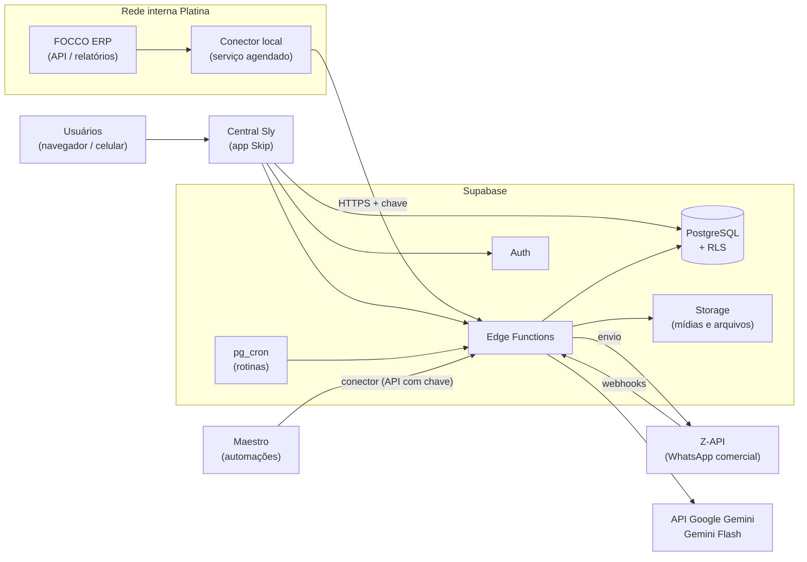

# Escopo Definitivo — Central de Inteligência Comercial Sly Parts

| | |
|---|---|
| **Empresa** | Platina Indústria e Comércio de Autopeças S.A. (marca Sly Parts) |
| **Projeto** | Adapta Labs Native — 21/09/2026 a 21/01/2027 |
| **Sistema** | Central de Inteligência Comercial Sly Parts ("Central Sly") |
| **Plataforma** | Skip (interface) + Supabase (banco, autenticação, funções e rotinas agendadas) |
| **Integrações** | FOCCO ERP (leitura) · Z-API (WhatsApp) · API Google Gemini Flash (IA) · Maestro (automações) |
| **Versão** | 2.2 — 08/10/2026 — escopo definitivo em duas fases |
| **Responsável Adapta** | Kimberly Prestes |
| **Responsáveis Platina** | Gabrielle Brust (sponsor) · Ângela Ferreira (dona do processo comercial) · Marco Carvalho (TI) |

**Fontes:** Kickoff (21/09/2026), 1ª Consultoria (28/09/2026), vídeos de mapeamento (*Monitoramento da carteira e identificação de oportunidades*, *Consulta de peças*, *Inserção de pedido do cliente recorrente*, *Entrada de pedido*, *Consulta de estoque*, *Faturamento KSPG*), DMO, *VENDAS Indicadores 2026*, *Mapeamento Básico Vendas*, *Procedimento Atual Vendas/PCP*, *COMERCIAL – Fluxo atual / Lean Office / VSM x Agentes de IA*, VSMs da equipe comercial e escopo anterior (`01-Escopo.md`).

---

## Sumário

1. Contexto e problema
2. Objetivo e resultado esperado
3. Decisões de escopo
4. Usuários, perfis e permissões
5. Arquitetura da solução
6. Integrações
7. Modelo de dados
8. Motor de regras (sinais, prioridade e estagnação)
9. Módulos e telas
10. Automações e rotinas agendadas
11. Inteligência artificial
12. Requisitos não funcionais (segurança, LGPD, desempenho)
13. Fases, cronograma e critérios de aceite
14. Indicadores de sucesso
15. Fora do escopo e evoluções futuras
16. Riscos e mitigações
17. Responsabilidades
18. Rastreabilidade

---

## 1. Contexto e problema

A Platina fabrica pistões, pinos e jogos de pistões para o mercado de reposição automotiva. Atende uma **carteira fixa e recorrente de distribuidores** (rede nomeada), com uma supervisora de vendas (Ângela) e quatro vendedores/analistas (Camila, Marcio, Tatiele e Thiago), quase todos com 15 a 20 anos de casa. Hoje a restrição da empresa é **vendas**, e não produção (Kickoff).

A operação comercial é **passiva**: o cliente manda o pedido, o vendedor consulta o estoque no FOCCO, lança o pedido e o que falta vira pendência. Não há nenhum mecanismo que avise quando um cliente reduz as compras, deixa de comprar uma linha ou passa do prazo em que costuma recomprar.

| Problema | Evidência |
|---|---|
| Ninguém sabe o que o cliente **deixou de comprar** | O relatório pedido à TI veio errado e não é usado; a percepção depende da conversa (vídeo *Monitoramento da carteira*, 05:19) |
| Acompanhamento da carteira **manual** | A coordenação calcula à mão a média de 6 meses dos 2–3 maiores clientes por estado no fechamento (05:59) |
| Prospecção **sem nenhum indicador** | "Não temos um indicador para medir esse processo" (09:59) |
| CRM do FOCCO **contratado e nunca usado** | Interface pouco amigável (Kickoff) |
| Itens **curva C/D** parados por não atingirem lote mínimo | "O sistema poderia dizer ao vendedor: vá atrás do cliente…" (Kickoff, Gabrielle) |
| Conversas com clientes **não ficam registradas** | ~70% WhatsApp, 20% Teams, restante e-mail e telefone (1ª Consultoria, Ângela) |
| Perda comercial relevante | 6.292 peças de venda perdida no acumulado de 2026; venda não atendida de 10,98% (Indicadores Vendas 2026) |
| Busca de dados no ERP lenta | Cada consulta no FOCCO passa pelo Java WebStart, com 13 a 41 s de espera por tela (vídeos) |

---

## 2. Objetivo e resultado esperado

**Objetivo:** transformar a carteira passiva em **demanda ativa e sistemática**.

**Resultado esperado:** todo dia útil, cada vendedor abre a Central Sly e encontra **a lista do que precisa fazer, com quem e por quê**, em ordem de valor. Cada ação termina com um resultado registrado. A supervisora vê em tempo real o que foi feito, o que está parado e quanto faturamento foi recuperado. As conversas de WhatsApp ficam na ficha do cliente. A IA mantém o CRM atualizado a partir dessas conversas.

---

## 3. Decisões de escopo

| # | Decisão | Motivo |
|---|---|---|
| D1 | O sistema é de **inteligência comercial da carteira**. O escopo de PCP (`01-Escopo.md`) vira evolução futura | Restrição atual é vendas; definido na 1ª Consultoria |
| D2 | **Regras fixas primeiro, IA por último** | Previsibilidade, custo baixo e auditabilidade; "tronco antes de galho" |
| D3 | O **FOCCO continua sendo o sistema oficial**. A Central Sly **só lê** do FOCCO e nunca grava nele | Evita risco fiscal/operacional e dupla digitação |
| D4 | Integração com o FOCCO por **conector local** dentro da rede da Platina, que envia os dados ao Supabase | O FOCCO roda na rede interna (`192.168.0.101/foccoweb`) e não é acessível pela internet |
| D5 | Quando a API do FOCCO não oferecer um dado, ele entra por **importação de arquivo** (Excel/XML exportado do próprio FOCCO) | Os relatórios do FOCCO já exportam nesses formatos |
| D6 | **CRM próprio centrado na ficha do cliente**. O funil existe **somente para clientes novos** | Carteira fixa e recorrente; o funil não é a rotina (Ângela, 1ª Consultoria) |
| D7 | **WhatsApp via Z-API** no número comercial único, com caixa de conversas dentro do sistema e roteamento por carteira | Mais barato que plataformas prontas; menos instável (1ª Consultoria) |
| D8 | **Proibido disparo em massa**; o WhatsApp é usado só para atendimento um a um, com limites técnicos | Evita bloqueio do número |
| D9 | Teams, e-mail e telefone são **registrados manualmente** na ficha (1 clique) | Integração automática não compensa nesta fase |
| D10 | IA via **API Google Gemini (modelo Gemini Flash)** chamada pelo Supabase, fora dos créditos do Maestro | Custo por mensagem baixo; separação entre determinístico e IA |
| D11 | **Maestro** consome a Central Sly por conector para briefings e relatórios agendados | Definido na 1ª Consultoria |
| D12 | Interface **responsiva** (computador e celular) | Vendedores atendem também pelo celular |
| D13 | Todos os limites das regras ficam numa **tela de parâmetros** editável pela supervisora | Ajuste fino sem desenvolvimento |
| D14 | **Duas fases**: a fase 1 entrega todo o sistema com dados do FOCCO importados por planilha e sem nenhuma integração; a fase 2 acrescenta conector FOCCO, WhatsApp, IA e Maestro | Valor de uso desde a fase 1, sem depender de API, conta de WhatsApp ou contratação de IA; o risco técnico fica concentrado na fase 2 |
| D15 | **Estoque fora do escopo**: a consulta de estoque foi citada como desejo, condicionada à API do FOCCO, e não faz parte deste sistema | Foco na inteligência comercial da carteira; o estoque fica como evolução junto da visão de PCP |

---

## 4. Usuários, perfis e permissões

### 4.1 Usuários iniciais

| Pessoa | Perfil |
|---|---|
| Ângela Ferreira | Supervisora |
| Camila, Marcio, Tatiele, Thiago | Vendedor |
| Gabrielle Brust | Diretoria |
| Marco Carvalho | Administrador |
| Analista de PCP (1 usuário) | PCP |

A carteira de cada vendedor é carregada do **código de vendedor do cadastro de cliente no FOCCO**. Clientes sem vendedor no FOCCO ficam na carteira da supervisora até serem atribuídos.

### 4.2 Matriz de permissões

| Funcionalidade | Vendedor | Supervisora | Diretoria | PCP | Admin |
|---|---|---|---|---|---|
| Meu dia (ações próprias) | ✔ | ✔ (de todos) | — | — | — |
| Carteira e ficha do cliente | Só a própria carteira | Todas | Todas (leitura) | — | Todas (leitura) |
| Registrar resultado / interação | Própria carteira | Todas | — | — | — |
| Conversas de WhatsApp | Própria carteira | Todas + fila de não identificados | — | — | — |
| Enviar WhatsApp | Própria carteira | Todas | — | — | — |
| Funil de novos clientes | Próprios leads | Todos | Leitura | — | — |
| Pós-venda / ocorrências | Própria carteira | Todas | Leitura | Leitura | — |
| Oportunidades de lote C/D | Ações próprias | Todas | Leitura | Leitura + confirmar programação | — |
| Painéis de gestão | Próprios números | Todos | Todos | Lote C/D | Todos |
| Reatribuir clientes e ações | — | ✔ | — | — | ✔ |
| Parâmetros das regras | — | ✔ | — | — | ✔ |
| Usuários, integrações, importações | — | — | — | — | ✔ |
| Auditoria | — | Leitura | Leitura | — | ✔ |

As permissões são garantidas **no banco de dados** (Row Level Security do Supabase), e não apenas escondidas na tela.

---

## 5. Arquitetura da solução



| Camada | Tecnologia | Responsabilidade |
|---|---|---|
| Interface | **Skip** (React + TypeScript + Tailwind + shadcn/ui), publicado com link próprio | Telas, navegação e experiência do usuário |
| Autenticação | **Supabase Auth** (e-mail + senha; recuperação por e-mail) | Login individual por usuário |
| Banco de dados | **Supabase PostgreSQL** com Row Level Security | Dados, regras de acesso e cálculos em SQL |
| Lógica de servidor | **Supabase Edge Functions** | Recepção do conector, webhooks da Z-API, envio de mensagens, IA, endpoints do Maestro |
| Rotinas | **pg_cron** | Motor de regras, estagnação, métricas e limpezas |
| Arquivos | **Supabase Storage** | Mídias do WhatsApp e arquivos de importação |
| Segredos | **Supabase Secrets/Vault** | Tokens da Z-API, chave da API Gemini, chaves do conector e do Maestro |
| Integração ERP | **Conector local** (serviço em Node.js ou Python numa máquina da Platina) | Ler o FOCCO e enviar ao Supabase |

---

## 6. Integrações

### 6.1 FOCCO ERP (leitura)

**Modo de conexão:** um **conector local** é instalado num servidor ou máquina sempre ligada da rede da Platina. Ele consulta o FOCCO (pela API, quando disponível) e envia os dados por HTTPS à Edge Function `focco-ingest`, autenticado com uma chave exclusiva. Nada do FOCCO fica exposto à internet.

**Dados lidos:**

| Conjunto | Origem no FOCCO | Campos | Frequência |
|---|---|---|---|
| Clientes | Cadastro de clientes | código, razão social, nome fantasia, CNPJ, cidade, UF, tipo de cliente, segmento/mercado, divisão de venda, código do vendedor/representante, telefones, e-mails, situação (ativo/bloqueado) | Diária, 05:00 |
| Vendedores | Cadastro de vendedores | código, nome | Diária, 05:00 |
| Itens | Cadastro de itens | código (ex.: `PS 4938 0 50`), descrição, grupo/família (010 Pistão, 020 PCA, 030 KPM), linha (leve/pesada), classificação, situação | Diária, 05:00 |
| Faturamento | Notas fiscais de venda (base do relatório *COM – Vendas por Classificação*), empresa 1, classificação 30 | nº da nota, data de faturamento, cliente, item, quantidade, valor unitário, valor total, pedido de origem | Diária, 05:00 (reprocessa os últimos 7 dias) |
| Pedidos e pendências | Pedidos de venda / relatório de pendências | nº do pedido, cliente, item, quantidade solicitada, atendida e pendente, data do pedido, situação | Diária, 05:00 e 12:00 |
| Curva e lote mínimo | Curva ABC do FOCCO / planilha do PCP | item, curva (A/B/C/D), lote mínimo de produção | Semanal (segunda, 05:00) |

**Carga inicial:** **24 meses** de faturamento, todos os clientes ativos e bloqueados, todos os itens de produto acabado e as pendências abertas.

**Plano B (importação de arquivo):** quando a API não oferecer um conjunto, o administrador usa a tela **Importações** para enviar o arquivo exportado do FOCCO:

| Conjunto | Relatório FOCCO a exportar | Formato |
|---|---|---|
| Faturamento | *COM – Relatório de Vendas por Classificação* (empresa 1, classificação 30%, período) | Excel ou XML |
| Pendências | Relatório de pendências de vendas (FOCCOVISION) | Excel |
| Curva e lote mínimo | Curva ABC + planilha de lote mínimo do PCP | Excel (modelo fornecido pelo sistema) |

A importação valida o layout, mostra uma prévia com erros por linha e só grava depois de confirmada. Toda carga (automática ou por arquivo) gera registro em `integracao_execucoes` com quantidade de linhas, erros e duração.

**Regras de qualidade de dados:**
- Itens fora da classificação 30 são descartados.
- Notas canceladas ou devolvidas abatem o faturamento do mês correspondente.
- Cliente sem telefone celular cadastrado aparece na tela **Pendências de cadastro** do vendedor responsável.
- Se a carga diária falhar, o administrador e a supervisora recebem alerta, e as telas exibem "dados atualizados até dd/mm hh:mm".

### 6.2 Z-API (WhatsApp)

**Configuração:** uma instância Z-API conectada ao **número comercial** da Platina, lendo o QR Code com o aparelho atual. A conta, o ID da instância, o token e o *Client-Token* de segurança ficam guardados nos segredos do Supabase.

**Recebimento (webhooks → Edge Function `zapi-webhook`):**

| Webhook Z-API | Uso |
|---|---|
| Ao receber mensagem (`on-message-received`) | Grava a mensagem, identifica o contato e direciona a conversa |
| Status da mensagem (`on-message-status` / entrega) | Atualiza enviado → entregue → lido |
| Conexão / desconexão da instância | Alerta o administrador se o número desconectar |

A função valida um token secreto na URL do webhook, ignora mensagens de **grupos** e de **status/stories**, e é **idempotente**: o ID da mensagem é único, então reenvios não duplicam.

**Envio (Edge Function `zapi-enviar`):** usa os endpoints de envio da Z-API (`send-text`, `send-image`, `send-document`, `send-audio`) com o header `Client-Token`. O texto sai com a **assinatura do vendedor** na primeira linha (ex.: `*Marcio – Sly Parts:*`).

**Roteamento:**
1. O telefone recebido é normalizado (formato `55DDDNÚMERO`) e procurado em `contatos`.
2. Se for encontrado, a conversa é vinculada ao cliente e atribuída ao **vendedor responsável pela carteira**.
3. Se não for encontrado, o **agente de cadastro de leads** (§11.1) lê as primeiras mensagens e:
   - se identificar um cliente da carteira (por CNPJ, razão social ou nome citado), vincula o número como contato desse cliente;
   - se for um interessado novo, **cria o lead** no funil com os dados extraídos (nome, empresa, cidade/UF, interesse), origem WhatsApp, atribuído ao vendedor da UF (tabela de UF por vendedor nos Parâmetros) e com a ação "Primeiro contato";
   - se não tiver confiança suficiente, deixa a conversa na fila **"Não identificados"** da supervisora, que vincula a um cliente, cria o lead ou marca como irrelevante.
4. Mensagem recebida fora do horário comercial (antes das 08:00, depois das 18:00, fins de semana e feriados) fica marcada como "fora do horário" e aparece no topo do **Meu dia** seguinte.

**Proteções contra bloqueio do número (D8):**
- Não existe função de envio para listas. Cada mensagem é enviada a uma única conversa, por ação humana.
- No máximo **1 envio a cada 3 segundos** por número.
- No máximo **40 conversas iniciadas pela empresa por dia** (contatos que não escreveram nas últimas 24 h), parâmetro ajustável.
- Mensagens de IA nunca são enviadas automaticamente.

**Mídias:** imagens, áudios, PDFs e planilhas recebidos são copiados para o Supabase Storage (`whatsapp-midias/AAAA/MM/`) e exibidos na conversa. Fotos de pedido ficam acessíveis na ficha do cliente.

**Uso do aparelho:** depois da implantação, a equipe atende **somente pela Central Sly**. O aparelho continua conectado, apenas como dispositivo da instância.

### 6.3 API Google Gemini — Gemini Flash (fase 2)

- Chamada exclusivamente pelas Edge Functions `ia-analisar-conversa`, `ia-resumo-cliente` e `ia-sugerir-mensagem`. A chave nunca vai para o navegador.
- Modelo: **Gemini Flash**, na versão estável mais recente disponível na Gemini API no início da fase 2. O nome do modelo fica num parâmetro do sistema, o que permite trocar de versão sem alterar código. Foi escolhido pelo custo baixo e por ser adequado a classificação, extração e resumo.
- Acesso pela Gemini API (Google AI Studio / Google Cloud), com chave guardada nos segredos do Supabase.
- As respostas usam a saída estruturada nativa do Gemini (JSON com schema definido) e são validadas antes de gravar. Respostas fora do formato são descartadas e registradas.
- **Teto mensal de gasto** configurável. Ao atingir 80% dele, o administrador é alertado; ao atingir 100%, a IA pausa e o sistema continua funcionando sem ela.

### 6.4 Maestro (fase 2)

A Central Sly expõe endpoints de leitura protegidos por chave (Edge Function `maestro-api`), cadastrados como conector no Maestro:

| Endpoint | Retorno |
|---|---|
| `GET /briefing-diario?vendedor=` | Ações do dia do vendedor (top 10 por prioridade), ações atrasadas e conversas sem resposta |
| `GET /resumo-supervisao` | Ações concluídas, atrasadas, alertas abertos e clientes em queda sem contato, por vendedor |
| `GET /resumo-semanal` | Indicadores da seção 14 da semana e comparação com a semana anterior |

**Automações configuradas no Maestro:**
- **07:30, dias úteis:** mensagem no WhatsApp pessoal de cada vendedor (enviada pelo número comercial via Z-API) com os clientes e leads que ele precisa acionar no dia, com nome, motivo curto e **telefone de cada um**. Cópia por e-mail.
- **08:00, dias úteis:** resumo de supervisão para a Ângela.
- **Segunda, 08:00:** resumo semanal para Gabrielle e Ângela.

---

## 7. Modelo de dados

Descrição das tabelas do Supabase. Todas têm `id`, `criado_em` e `atualizado_em`.

### 7.1 Cadastros

| Tabela | Campos principais | Observações |
|---|---|---|
| `perfis` | usuário (Auth), nome, e-mail, papel (vendedor, supervisora, diretoria, pcp, admin), código de vendedor FOCCO, ativo | Um por usuário |
| `clientes` | código FOCCO (único), razão social, nome fantasia, CNPJ, cidade, UF, mercado (reposição direta, reposição indireta, indústria, exportação), segmento, vendedor responsável, situação FOCCO, **situação comercial** (calculada), mercado maduro (S/N, pela UF) | Origem: FOCCO |
| `contatos` | cliente, nome, cargo, telefone normalizado (único), e-mail, principal (S/N), origem (FOCCO, manual, WhatsApp) | Um cliente tem vários contatos |
| `itens` | código FOCCO (único), descrição, família (Pistão linha leve, Pistão linha pesada, Pistão em jogos, PCA, KPM, Pino, Outros), grupo FOCCO, curva (A/B/C/D), lote mínimo, ativo | Origem: FOCCO + planilha PCP |
| `historico_carteira` | cliente, vendedor anterior, vendedor novo, quem alterou, quando, motivo | Auditoria de troca de carteira |
| `feriados` | data, descrição | Cálculo de dias úteis |

### 7.2 Dados comerciais (vindos do FOCCO)

| Tabela | Campos principais | Observações |
|---|---|---|
| `faturamento_itens` | nº nota, data, cliente, item, quantidade, valor unitário, valor total, pedido | Chave única: nota + item; base de todas as métricas |
| `pendencias` | pedido, cliente, item, quantidade pendente, data do pedido, situação (aberta, atendida, cancelada), dias em aberto | Atualizada 2x ao dia |
| `metricas_cliente_mensal` | cliente, mês, peças, valor, nº de notas, famílias compradas | Recalculada após cada carga |
| `metricas_cliente_atual` | cliente, média mensal 6m (R$ e peças), média dos últimos 60 dias, variação %, data da última compra, intervalo médio entre compras, dias sem compra, ticket médio, famílias ativas, famílias abandonadas, situação comercial | Uma linha por cliente; base dos painéis |

### 7.3 Operação comercial

| Tabela | Campos principais | Observações |
|---|---|---|
| `sinais` | cliente, tipo (queda de consumo, recompra vencida, família abandonada, item-chave abandonado, cliente silencioso, cliente inativo, pendência antiga, lote C/D), severidade (atenção, crítica), valor em risco R$, evidência (texto com os números), data de detecção, situação (ativo, tratado, expirado) | Gerado pelo motor de regras |
| `acoes` | cliente ou lead, vendedor, sinal de origem (opcional), tipo (reativação, lote C/D, pendência, retorno agendado, compromisso, primeiro contato, follow-up, pós-venda, prospecção, manual), título, descrição, prioridade (pontuação + faixa alta/normal), data prevista, hora (compromissos), prazo (SLA), situação (aberta, em andamento, concluída, cancelada), resultado, observação, valor de pedido informado, data de retorno, origem (motor, manual, IA) | Coração do "Meu dia" |
| `resultados_tipo` | código, descrição, exige data de retorno (S/N), exige motivo (S/N), encerra sinal (S/N) | Lista fixa, editável pelo admin |
| `motivos_perda` | código, descrição | Preço, prazo de entrega, falta de produto, concorrente com rebate, concorrente importado, estoque alto no cliente, qualidade, crédito, outro |
| `interacoes` | cliente ou lead, usuário, canal (WhatsApp, telefone, Teams, e-mail, visita), direção (entrada, saída), resumo, data, ação vinculada, origem (manual, automática, IA) | Linha do tempo da ficha do cliente |
| `alertas` | tipo (ação parada, cliente em queda sem contato, vendedor sobrecarregado, lote parado, integração falhou, WhatsApp desconectado), destinatário, referência, mensagem, situação (aberto, lido, resolvido), data | Exibidos no sino da interface |

### 7.4 CRM de novos clientes e pós-venda

| Tabela | Campos principais |
|---|---|
| `leads` | razão social, CNPJ, cidade, UF, contato, telefone, e-mail, origem (site, feira, representante, indicação, WhatsApp, outro), vendedor, etapa, potencial mensal estimado (R$), linhas de interesse, mercado maduro (S/N), justificativa de mercado, motivo de perda, cliente gerado (quando convertido) |
| `leads_etapas_historico` | lead, etapa anterior, etapa nova, usuário ou IA, data |
| `ocorrencias` | cliente, tipo (qualidade, entrega, nota fiscal, divergência de peças, outro), descrição, nota/pedido, responsável, área encaminhada, situação (aberta, em tratamento, resolvida), data de abertura, data de resolução |

### 7.5 Lotes curva C/D

| Tabela | Campos principais |
|---|---|
| `oportunidades_lote` | item, curva, lote mínimo, pendência atual, compromissos somados, quantidade faltante, valor potencial, situação (aberta, lote atingido, enviada ao PCP, programada, encerrada sem lote), data de abertura |
| `compromissos_lote` | oportunidade, cliente, vendedor, quantidade comprometida, data, convertido em pedido (S/N) |

### 7.6 WhatsApp

| Tabela | Campos principais |
|---|---|
| `conversas` | telefone, contato, cliente ou lead, vendedor atribuído, situação (aberta, aguardando cliente, aguardando vendedor, encerrada, não identificada), última mensagem em, não lidas |
| `mensagens` | conversa, ID Z-API (único), direção, tipo (texto, imagem, áudio, documento, outro), conteúdo, mídia (caminho no Storage), enviada por (usuário), status (enviada, entregue, lida, falhou), data |

### 7.7 Sistema

| Tabela | Campos principais |
|---|---|
| `parametros` | chave, valor, descrição, alterado por, alterado em (valores da seção 8) |
| `integracao_execucoes` | origem (conector, importação, Z-API), conjunto, início, fim, linhas lidas, inseridas, atualizadas, com erro, situação, mensagem de erro |
| `ia_execucoes` | função, conversa/cliente, tokens de entrada e saída, custo estimado, resultado (JSON), aplicado (S/N), revertido (S/N), por quem |
| `auditoria` | usuário, tabela, registro, operação, dados anteriores, dados novos, data |

---

## 8. Motor de regras

Roda todos os dias úteis às **05:30**, depois da carga do FOCCO. É 100% determinístico (SQL), sem IA. Todos os números abaixo são os valores iniciais da tabela `parametros`.

### 8.1 Métricas base por cliente

- **Média mensal 6m:** média de R$ e de peças faturados nos 6 meses fechados anteriores aos últimos 60 dias.
- **Média recente:** faturamento dos últimos 60 dias ÷ 2.
- **Variação:** (média recente ÷ média mensal 6m) − 1.
- **Intervalo médio entre compras:** média de dias entre datas de faturamento distintas nos últimos 12 meses.
- **Ticket médio:** valor faturado em 12 meses ÷ nº de notas em 12 meses.
- **Cliente elegível para regras de consumo:** média mensal 6m ≥ **R$ 1.500** e pelo menos **4 faturamentos** em 12 meses. Clientes do mercado **indústria** e **exportação** (pedido firme) ficam fora das regras de queda e recompra, mas entram nas regras de pendência e lote.

### 8.2 Sinais

| Sinal | Regra de disparo | Severidade | Valor em risco (R$) |
|---|---|---|---|
| **Queda de consumo** | Variação ≤ −30% | Atenção: −30% a −50% · Crítica: < −50% | média mensal 6m − média recente |
| **Recompra vencida** | Dias sem compra > maior entre (intervalo médio × 1,3) e (intervalo médio + 10 dias) | Atenção; crítica quando passar de 2× o intervalo médio | média mensal 6m |
| **Família abandonada** | Família comprada em ≥ 3 dos 6 meses de referência e **zero** nos últimos 60 dias | Atenção | média mensal da família no período de referência |
| **Item-chave abandonado** | Item que somava ≥ 5% do valor comprado pelo cliente em 12 meses e não foi comprado nos últimos 90 dias | Atenção | média mensal do item |
| **Cliente silencioso** | 45 dias sem faturamento **e** sem interação registrada | Crítica | média mensal 6m |
| **Cliente inativo** | 120 dias sem faturamento | Crítica (gera 1 ação de reconquista por mês) | média mensal 6m |
| **Pendência antiga** | Pendência aberta há mais de 30 dias | Atenção | quantidade × último preço do cliente |
| **Lote C/D** | Ver 8.4 | Atenção | quantidade faltante × preço médio do item |

**Situação comercial do cliente** (exibida em toda a interface):
- **Ativo:** sem sinais ativos.
- **Em atenção:** 1 sinal de severidade atenção.
- **Em queda:** sinal crítico de queda ou recompra, ou 2 ou mais sinais ativos.
- **Inativo:** 120 dias ou mais sem faturamento.

**Encerramento de sinais:**
- Um sinal é encerrado **automaticamente** quando a condição deixa de existir (o cliente voltou a comprar, a pendência foi atendida).
- Também é encerrado quando a ação vinculada recebe um resultado que encerra sinal.
- O mesmo tipo de sinal para o mesmo cliente só gera nova ação **30 dias** depois do último resultado, a não ser que a severidade piore.

### 8.3 Geração de ações e prioridade

Às **06:00** de cada dia útil, cada sinal ativo sem ação aberta gera uma ação para o vendedor responsável pelo cliente.

**Pontuação de prioridade:**

```
pontuação = valor em risco (R$) × peso do sinal × fator de atraso
```

| Sinal | Peso |
|---|---|
| Queda de consumo crítica | 1,0 |
| Cliente silencioso | 0,9 |
| Recompra vencida | 0,9 |
| Lote C/D | 0,8 |
| Queda de consumo atenção | 0,8 |
| Família / item-chave abandonado | 0,7 |
| Pendência antiga | 0,6 |
| Cliente inativo | 0,5 |

- **Fator de atraso:** 1 + 0,1 por dia útil de atraso, com limite de 2,0.
- **Retornos agendados** pelo próprio vendedor entram no dia marcado, com prioridade máxima.
- **Faixa alta:** pontuação entre os 30% maiores da carteira do vendedor, ou qualquer sinal crítico. Os demais são **faixa normal**.
- **Limite diário:** o "Meu dia" mostra no máximo **15 ações automáticas novas** por vendedor, mais retornos agendados e ações atrasadas. O excedente fica na aba **Fila** e entra nos dias seguintes por ordem de pontuação.

### 8.4 Oportunidades de lote curva C/D

1. Toda segunda-feira e após cada carga de pendências, o sistema verifica os itens de **curva C ou D** com pendência aberta abaixo do **lote mínimo**.
2. Para cada item, abre ou atualiza uma **oportunidade de lote**, com quantidade faltante = lote mínimo − pendência − compromissos.
3. Seleciona até **5 clientes sugeridos**: os que compraram o item nos últimos 12 meses, ordenados por volume, sem pendência do item e com situação diferente de "Inativo".
4. Gera uma ação "Oferecer item X" para o vendedor de cada cliente sugerido.
5. Quando o vendedor registra o resultado **"Cliente vai comprar"** com quantidade, ela entra como compromisso.
6. Quando **pendência + compromissos ≥ lote mínimo**, a oportunidade muda para **"Lote atingido"**, o PCP e a supervisora recebem alerta, e o PCP marca "Programada" com a data prevista. Essa data aparece na ficha dos clientes envolvidos.
7. Compromissos sem pedido no FOCCO em 15 dias voltam a ser ação de retorno para o vendedor.

### 8.5 Estagnação e alertas para a gestão

Verificado **de hora em hora, das 08:00 às 18:00**, em dias úteis:

| Alerta | Regra | Destinatário |
|---|---|---|
| Ação parada | Ação de faixa alta sem resultado depois de **2 dias úteis**; faixa normal depois de **5 dias úteis** | Supervisora |
| Cliente em queda sem contato | Cliente "Em queda" sem interação há **7 dias** | Supervisora |
| Vendedor sobrecarregado | Mais de **10 ações atrasadas** | Supervisora |
| Conversa sem resposta | Mensagem de cliente sem resposta depois de **4 horas úteis** | Vendedor; depois de 8 horas úteis, também a supervisora |
| Lote parado | Oportunidade de lote sem novo compromisso há **15 dias** | Supervisora |
| Lote atingido | Pendência + compromissos ≥ lote mínimo | PCP e supervisora |
| Integração | Carga do FOCCO falhou ou WhatsApp desconectado | Admin e supervisora |

### 8.6 Medição de resultado

- **Cliente reativado:** cliente "Em queda", "Silencioso" ou "Inativo" que, nos **45 dias** seguintes a uma ação de reativação concluída, fatura pelo menos **50% da média mensal 6m**.
- **Faturamento recuperado:** soma do faturamento dos clientes reativados nos 60 dias seguintes à ação, menos a média recente que tinham antes da ação.
- **Conversão de lote:** peças de compromissos que viraram pedido no FOCCO.

---

## 9. Módulos e telas

### 9.1 Login
E-mail e senha, recuperação por e-mail. Após o login, o vendedor vai para **Meu dia**, a supervisora para **Supervisão**, a diretoria para **Painéis** e o PCP para **Lotes C/D**.

### 9.2 Meu dia (vendedor)
- **Cabeçalho:** data, contadores (ações de hoje, atrasadas, concluídas, conversas não lidas) e "dados atualizados até…".
- **Blocos, nesta ordem:**
  1. Agenda de hoje (compromissos com horário)
  2. Retornos agendados para hoje
  3. Atrasadas
  4. Novos leads (primeiro contato e follow-ups)
  5. Novas de hoje, por pontuação
  6. Mensagens recebidas fora do horário (fase 2)
- **Cartão da ação:** cliente, situação comercial, motivo com números (ex.: "Comprou R$ 18.400 nos últimos 60 dias; média de R$ 41.200/mês (−55%)"), valor em risco e botões **Abrir ficha**, **Abrir WhatsApp**, **Registrar resultado**.
- **Registrar resultado:** modal com a lista de resultados (9.2.1). Campos de data, motivo, valor e quantidade aparecem conforme o resultado escolhido.
- **Aba Fila:** ações excedentes ao limite diário.
- **Botão "Nova ação":** cria uma ação manual para qualquer cliente da carteira.

#### 9.2.1 Resultados possíveis

| Resultado | Exige | Encerra sinal |
|---|---|---|
| Pedido gerado | valor aproximado | Sim |
| Cliente vai comprar | data prevista; quantidade (em lote C/D) | Não (gera retorno) |
| Retornar em outra data | data | Não |
| Reunião/visita agendada | data, hora, tipo e assunto | Não (gera compromisso na agenda) |
| Cliente com estoque alto | data para retomar | Sim |
| Comprando de concorrente | motivo de perda + concorrente (texto) | Sim |
| Problema de atendimento ou qualidade | abre ocorrência de pós-venda | Sim |
| Sem contato | nova tentativa (data) | Não |
| Pendência liberada / combinada | — | Sim |
| Não se aplica | justificativa | Sim |

### 9.3 Carteira
Lista de clientes da carteira (todas as carteiras para a supervisora) com:
- situação comercial;
- média 6m;
- média recente e variação;
- dias sem compra;
- última interação;
- sinais ativos;
- vendedor.

Filtros por vendedor, UF, mercado, situação, família abandonada e "sem contato há X dias". Ordenação por qualquer coluna. Exportação em Excel. Bloco **Top clientes por UF** (os 3 maiores por estado, com média móvel de 6 meses e gráfico de tendência), substituindo o cálculo manual do fechamento.

### 9.4 Ficha do cliente (visão 360°)
- **Cabeçalho:** nome, código FOCCO, UF/cidade, mercado, vendedor, situação comercial, contatos (com botão de WhatsApp).
- **Indicadores:** média 6m, média recente, variação, ticket médio, dias sem compra, intervalo médio.
- **Gráfico:** faturamento mensal de 24 meses (R$ e peças).
- **Mix:** tabela de famílias e itens-chave, com última compra e situação (ativa/abandonada).
- **Pendências:** abertas, com dias em aberto.
- **Sinais ativos** e **ações** (abertas e histórico com resultados).
- **Linha do tempo:** interações de todos os canais, mensagens de WhatsApp, ocorrências e mudanças de carteira.
- **Resumo da IA** (fase 2): "Última conversa, o que ficou combinado, o que mudou".
- **Ações rápidas:** registrar contato (telefone, Teams, e-mail ou visita), criar ação, abrir ocorrência, iniciar conversa.

### 9.5 Oportunidades
Painel com três abas:
- **Reativação:** clientes com sinais, por valor em risco.
- **Lotes C/D:** item, lote mínimo, pendência, compromissos, faltante, clientes sugeridos e situação.
- **Novos clientes:** leads ativos.

### 9.6 Funil de novos clientes
- **Kanban** com as etapas: `Lead recebido` → `Formulário de cadastro enviado` → `Formulário recebido` → `Análise de crédito` → `Validação de mercado` → `Proposta enviada` → `Primeiro pedido` → `Cliente ativo`. Coluna lateral `Perdido`, com motivo obrigatório.
- **Validação de mercado:** em UF de mercado maduro (SP, RS, MG, SC, PR), o lead só avança se tiver potencial mensal estimado **≥ R$ 10.000** ou se trouxer **linha de produto ainda não vendida na região**. Caso contrário, o avanço exige aprovação da supervisora com justificativa.
- **Primeiro pedido:** quando o CNPJ do lead aparece como cliente com faturamento no FOCCO, o lead é convertido automaticamente em "Cliente ativo" e vinculado ao cadastro.
- Todo lead novo gera a ação **"Primeiro contato"** no Meu dia do vendedor no mesmo dia; leads em espera seguem a cadência de follow-up (§9.9).
- Cada etapa mostra os dias parados. Leads parados mais de 10 dias em outras etapas geram ação para o vendedor.
- **Fase 2:** os agentes de IA criam leads a partir de números novos no WhatsApp e movem os cartões conforme as conversas (§11.1).

### 9.7 Pós-venda
Lista de **ocorrências** (qualidade, entrega, nota fiscal, divergência de peças, outro), com responsável, área encaminhada, prazo e situação. O vendedor recebe automaticamente uma **ação de acompanhamento**:
- 7 dias depois de toda ocorrência resolvida;
- 10 dias depois de todo primeiro pedido de cliente reativado.

### 9.8 Conversas (WhatsApp)
- **Lista de conversas** da carteira, com filtros (não lidas, aguardando vendedor, aguardando cliente, encerradas) e busca.
- **Painel da conversa:** histórico, envio de texto, imagem e documento, respostas rápidas cadastradas pela supervisora e status de entrega/leitura.
- **Painel lateral:** dados do cliente, situação, ações abertas e botão "Registrar resultado".
- **Aba Não identificados** (supervisora): vincular a cliente, criar lead ou descartar.
- A supervisora pode **transferir** uma conversa para outro vendedor.
- **Fase 2:** botão **"Sugerir resposta"** (IA); o texto vem para edição e nunca é enviado sem ação humana.

### 9.9 Agenda e follow-up
- **Agenda:** o resultado **"Reunião/visita agendada"** registra data, hora, tipo (ligação, reunião on-line, visita) e assunto. O compromisso aparece no bloco **"Agenda de hoje"** do Meu dia, em ordem de horário, e na ficha do cliente ou do lead. Depois do horário, o compromisso pede resultado como qualquer ação.
- **Follow-up de leads:**
  - todo lead novo gera, no mesmo dia, a ação **"Primeiro contato"** (faixa alta);
  - leads em etapa de espera (`Formulário de cadastro enviado` e `Proposta enviada`) geram follow-up automático depois de **3 dias úteis** sem mudança de etapa, e um segundo follow-up depois de **mais 4 dias úteis**;
  - sem avanço depois do segundo follow-up, a supervisora recebe alerta e o lead fica marcado "Sem resposta".
- **Follow-up da carteira:** os retornos combinados ("Cliente vai comprar", "Retornar em outra data", "Sem contato", "Cliente com estoque alto") voltam sozinhos no Meu dia na data marcada.

### 9.10 Supervisão (supervisora)
- **Quadro por vendedor:** ações de hoje, concluídas, atrasadas, conversas sem resposta, clientes em queda sem contato.
- **Alertas abertos** com ação direta (reatribuir, comentar, assumir).
- **Reatribuição** de clientes e ações, individual ou em lote.

### 9.11 Painéis de gestão
- **Execução:** ações geradas, concluídas e no prazo (% por vendedor e semana).
- **Saúde da carteira:** clientes por situação ao longo do tempo; valor em risco total.
- **Resultado:** clientes reativados, faturamento recuperado, conversão de lotes C/D.
- **Motivos:** ranking de motivos de perda e concorrentes citados.
- **Prospecção:** leads por origem, conversão por etapa, tempo médio até o primeiro pedido.
- **Atendimento WhatsApp:** tempo médio de primeira resposta, conversas por vendedor.

### 9.12 Administração
- **Usuários:** criar, desativar e definir perfil e código FOCCO.
- **Parâmetros:** todos os valores da seção 8, com histórico de alterações.
- **Integrações:** situação do conector FOCCO (última execução, erros), situação da instância Z-API (conectada/desconectada), consumo da IA no mês.
- **Importações:** envio de arquivos (plano B), prévia, erros e confirmação.
- **Cadastros auxiliares:** feriados, resultados, motivos de perda, respostas rápidas.
- **Auditoria:** consulta das alterações.

---

## 10. Automações e rotinas agendadas

| Horário | Rotina | O que faz |
|---|---|---|
| 05:00 (diária) | Carga FOCCO | Conector local envia clientes, itens, faturamento (últimos 7 dias), pendências |
| 05:15 | Recalcular métricas | Atualiza `metricas_cliente_mensal` e `metricas_cliente_atual` |
| 05:30 (dias úteis) | Motor de sinais | Abre, atualiza e encerra sinais (seção 8.2) e oportunidades de lote (8.4) |
| 06:00 (dias úteis) | Gerar ações | Cria as ações do dia e aplica o limite por vendedor (8.3) |
| 08:00–18:00, de hora em hora | Estagnação | Gera alertas (8.5) |
| 12:00 | Pendências | Segunda carga de pendências do dia |
| Segunda, 05:00 | Curva e lote mínimo | Atualiza curva e lote mínimo dos itens |
| Contínuo | Webhook Z-API | Recebe, grava e roteia mensagens |
| A cada 30 min (fase 2) | IA nas conversas | Analisa conversas com 30 min sem nova mensagem (seção 11) |
| 07:30 / 08:00 / segunda 08:00 (fase 2) | Maestro | Briefing dos vendedores, resumo de supervisão e resumo semanal |
| Domingo, 03:00 | Manutenção | Expira sinais antigos, arquiva conversas encerradas há 90 dias e limpa arquivos de importação com mais de 30 dias |

> **Na fase 1 (sem integrações):** não há carga automática às 05:00. As rotinas de métricas, sinais e ações rodam logo depois da importação manual do faturamento e, como garantia, às 09:30 dos dias úteis. A estagnação roda normalmente de hora em hora. As rotinas de WhatsApp, IA e Maestro só existem a partir da fase 2.

---

## 11. Inteligência artificial (fase 2)

A IA trabalha como **agentes dentro do próprio sistema**, chamados pelas Edge Functions com o Gemini Flash:

| Agente | Quando atua | O que faz |
|---|---|---|
| **Agente de cadastro de leads** | Mensagem de número que não está nos contatos | Identifica se é cliente da carteira ou interessado novo; vincula o contato ou cria o lead no funil com os dados extraídos e a ação "Primeiro contato" |
| **Agente de CRM** | Conversa 30 min sem nova mensagem | Resume, registra resultado, retorno e agendamento, move o lead de etapa, abre ocorrência e registra concorrente (11.1) |
| **Agente de follow-up** | Follow-up de lead ou retorno do Meu dia | Redige a mensagem de follow-up ou de reativação para o vendedor revisar e enviar (11.3) |

### 11.1 Análise de conversas → atualização do CRM

Quando uma conversa fica **30 minutos sem nova mensagem**, a função `ia-analisar-conversa` envia ao Gemini Flash as mensagens novas, os dados do cliente e as ações abertas. A IA devolve um JSON com:

| Campo | Exemplo |
|---|---|
| resumo | "Cliente informou que está com estoque alto de linha leve; pediu cotação de linha pesada." |
| intenção | pedido, cotação, reclamação, dúvida, negociação, sem intenção comercial |
| resultado sugerido para a ação aberta | Cliente vai comprar · data 20/10 |
| retorno combinado | data e assunto |
| agendamento | data, hora, tipo (ligação, reunião, visita) |
| lead novo (número desconhecido) | nome, empresa, CNPJ, cidade/UF, interesse |
| reclamação detectada | tipo e descrição |
| concorrente citado | nome |
| itens citados | códigos/descrições |
| etapa sugerida (lead) | Proposta enviada |
| confiança | 0 a 1 |

**Aplicação:**

| O que a IA faz | Primeiros 30 dias | Depois de 30 dias (com taxa de aprovação ≥ 85%) |
|---|---|---|
| Registrar resumo como interação na linha do tempo | Automático | Automático |
| Criar lead a partir de número novo | Automático quando confiança ≥ 0,8; senão fila "Não identificados" | Automático quando confiança ≥ 0,8 |
| Criar ação de retorno na data combinada | Sugestão (vendedor aprova) | Automático, quando confiança ≥ 0,8 |
| Registrar reunião/visita agendada | Sugestão | Automático, quando confiança ≥ 0,8 |
| Registrar resultado em ação aberta | Sugestão | Sugestão |
| Mover lead de etapa no kanban (até "Proposta enviada") | Sugestão | Automático, quando confiança ≥ 0,8 |
| Abrir ocorrência de pós-venda | Sugestão | Sugestão |
| Registrar concorrente citado | Automático | Automático |

Toda alteração feita pela IA aparece com o selo **"IA"** e um botão **Desfazer**. Aprovações e reversões ficam em `ia_execucoes` e calculam a taxa de aprovação.

### 11.2 Resumo do cliente
Na ficha do cliente, o botão **"Resumo"** gera um parágrafo com: situação comercial, últimas conversas, o que ficou combinado, pendências e sinais. Fica em cache por 24 horas ou até chegar uma nova mensagem.

### 11.3 Sugestão de mensagem
Na conversa ou no cartão da ação, a IA sugere um texto de abordagem a partir do sinal (ex.: recompra vencida, família abandonada, lote C/D) e do tom das conversas anteriores. O texto vai para a caixa de edição; **o envio é sempre do vendedor**.

### 11.4 Limites da IA
- Nunca envia mensagens.
- Nunca informa ou promete prazo, preço, desconto ou condição comercial.
- Nunca altera dados vindos do FOCCO.
- Usa somente dados do próprio cliente; nenhuma conversa de um cliente é enviada junto com a de outro.
- Quando atinge o teto de gasto, pausa sem afetar o restante do sistema.

---

## 12. Requisitos não funcionais

### 12.1 Segurança
- Row Level Security em **todas** as tabelas, de acordo com a matriz da seção 4.2.
- Tokens e chaves somente nos segredos do Supabase; nada sensível no código da interface.
- Webhook da Z-API validado por token secreto; conector FOCCO e Maestro autenticados por chaves próprias, revogáveis.
- Senhas com no mínimo 8 caracteres; sessão expira após 12 horas de inatividade.
- Auditoria de alterações em clientes, carteiras, ações, parâmetros e usuários.

### 12.2 LGPD
- Base legal: execução de contrato e legítimo interesse na relação comercial B2B.
- Dados pessoais limitados a nome, cargo, telefone e e-mail de contatos comerciais.
- Conversas retidas por **5 anos**. Contato que pedir exclusão é anonimizado pelo administrador.
- Acesso às conversas restrito ao vendedor da carteira, à supervisora e à diretoria.

### 12.3 Desempenho e disponibilidade
- Telas principais carregam em até **2 segundos** com 24 meses de histórico.
- Mensagem recebida aparece na Central Sly em até **5 segundos**.
- Backups diários automáticos do Supabase.
- Se a carga do FOCCO falhar, o sistema continua funcionando com os últimos dados e exibe a data da atualização.

### 12.4 Usabilidade
- Interface em português, responsiva e com a identidade visual Sly Parts.
- Registrar o resultado de uma ação leva no máximo **3 cliques**.
- Treinamento de 1 hora por perfil e manual rápido de 1 página por tela principal.

---

## 13. Fases, cronograma e critérios de aceite

O projeto tem **duas fases** dentro do prazo (até 21/01/2027):

- **Fase 1:** tudo o que é estrutural e funciona com dados carregados manualmente, **sem nenhuma integração**.
- **Fase 2:** as integrações e a automação externa.

O recesso de fim de ano vai de 24/12 a 04/01.

| Fase | Período | Entrega |
|---|---|---|
| **0. Preparação** | 08/10 – 16/10 | Supabase criado e conectado ao Skip; lista de usuários (e-mails e códigos de vendedor FOCCO); primeiras extrações do FOCCO nos layouts de planilha; pedido da documentação da API do FOCCO |
| **1. Sistema completo com dados manuais** | 19/10 – 04/12 | Autenticação e perfis; **importação manual por planilha** dos dados do FOCCO (carga de 24 meses e rotina diária); métricas; **Carteira**; **Ficha do cliente** com registro manual de contatos; **motor de sinais e ações**; **Meu dia** com resultado obrigatório, **agenda** e **follow-up**; **Supervisão**, alertas dentro do sistema e **Parâmetros**; **Funil de novos clientes**; **Pós-venda**; **Lotes C/D**; **Oportunidades**; **Painéis de gestão** e medição de resultado. **Sem nenhuma integração automática.** |
| **2. Integrações** | 07/12 – 21/01 | **Conector automático FOCCO** (conector local + API ou pasta de exportação, tela Integrações, alerta de carga atrasada); **WhatsApp (Z-API)** com Conversas por carteira, fila de não identificados e mídias; **agentes de IA (Gemini Flash)**: cadastro automático de leads do WhatsApp, atualização do CRM e do kanban pelas conversas, resumo do cliente e mensagens de follow-up; **Maestro**: mensagem diária ao vendedor com os contatos a acionar, resumo de supervisão e resumo semanal; **Reunião de resultados** |

**Como a fase 1 funciona sem integração:**
- Os dados do FOCCO entram pela tela Importações até as 09:00 de cada dia útil (faturamento e pendências) e às segundas (clientes, itens, curva e lote).
- Métricas, sinais e ações são recalculados logo depois da importação do faturamento. Às 09:30, se ainda não houve importação no dia, rodam com os dados disponíveis.
- Alertas aparecem só dentro do sistema (sino). E-mail e mensagens entram na fase 2.

### Critérios de aceite por fase

**Fase 1**
- [ ] Cada usuário entra com o próprio login e cai na tela do seu perfil; o vendedor vê somente a própria carteira, também testando direto no banco.
- [ ] A importação manual das planilhas do FOCCO valida o arquivo, mostra prévia e erros, grava só as linhas válidas e pode ser desfeita em até 24 h.
- [ ] O faturamento de 3 clientes escolhidos pela Ângela, num mês fechado, confere com o relatório *COM – Vendas por Classificação* do FOCCO (diferença zero).
- [ ] O bloco "Top clientes por UF" reproduz a média de 6 meses que a coordenação calcula hoje.
- [ ] O registro de um contato na ficha aparece na linha do tempo e na coluna "Última interação" da Carteira.
- [ ] Depois da importação do dia, todos os vendedores têm ações no Meu dia, com motivo e números; 10 sinais conferidos pela Ângela estão corretos.
- [ ] Uma ação não fecha sem resultado; resultados que exigem data ou motivo não salvam sem eles; o retorno agendado aparece no dia marcado.
- [ ] Uma ação de faixa alta parada por 2 dias úteis gera alerta para a supervisora; uma alteração de parâmetro vale na execução seguinte do motor.
- [ ] Todo lead novo gera "Primeiro contato" no mesmo dia; leads em espera geram os 2 follow-ups da cadência; reunião/visita agendada aparece na Agenda de hoje no horário certo.
- [ ] O lead percorre todas as etapas do funil, a regra de mercado maduro bloqueia ou exige justificativa, e o lead vira "Cliente ativo" quando o CNPJ aparece com faturamento importado.
- [ ] Uma ocorrência aberta a partir de um resultado gera ação de acompanhamento depois de resolvida.
- [ ] O item C/D com pendência abaixo do lote gera oportunidade com clientes sugeridos, e o PCP recebe o alerta quando o lote é atingido.
- [ ] Os painéis exibem os indicadores da seção 14 que não dependem de WhatsApp, incluindo clientes reativados e faturamento recuperado.

**Fase 2**
- [ ] A carga diária do FOCCO roda sozinha por 5 dias úteis seguidos, com registro em Integrações, e o atraso gera alerta às 06:30.
- [ ] Com a carga automática, as ações do Meu dia estão prontas às 06:00.
- [ ] Mensagem de um contato cadastrado aparece em até 5 s na conversa do vendedor certo; número desconhecido de interessado novo vira lead automaticamente (ou vai para Não identificados quando a IA não tem confiança).
- [ ] Mensagem enviada pelo sistema chega ao cliente com a assinatura do vendedor, e o status é atualizado; imagem e PDF recebidos ficam visíveis na conversa e na ficha.
- [ ] O limite de conversas iniciadas por dia bloqueia o excesso com aviso; a desconexão da instância gera alerta para o admin.
- [ ] Conversa com retorno combinado gera sugestão de ação com a data correta; toda alteração da IA tem selo e pode ser desfeita; o teto de gasto pausa a IA sem afetar o resto.
- [ ] O vendedor recebe às 07:30, no WhatsApp, a lista de clientes e leads a acionar no dia, com os telefones.

---

## 14. Indicadores de sucesso

Linha de base medida nas **duas primeiras semanas de uso do Meu dia (fase 1)**; indicadores de WhatsApp, nas duas primeiras semanas da fase 2. Metas avaliadas na reunião de resultados (janeiro/2027).

| Indicador | Situação hoje | Meta |
|---|---|---|
| Ações com resultado registrado | Não existe | ≥ 90% |
| Ações de faixa alta concluídas no prazo | Não existe | ≥ 80% |
| Clientes "Em queda" contatados em até 7 dias | Não medido | 100% |
| Clientes reativados (seção 8.6) | Não medido | ≥ 25% dos clientes acionados |
| Faturamento recuperado | Não medido | Medido e acompanhado mensalmente |
| Peças viabilizadas por lotes C/D | 0 | ≥ 3 lotes atingidos por demanda comercial |
| Tempo da coordenação no fechamento da carteira | ~1 a 2 dias/mês | Zero cálculo manual (painel pronto) |
| Conversão da prospecção (lead → primeiro pedido) | Não medido | Medido no painel |
| Leads com primeiro contato no mesmo dia | Não medido | ≥ 90% |
| Conversas do número comercial registradas na ficha | 0% | 100% |
| Tempo médio de primeira resposta no WhatsApp | Não medido | ≤ 2 horas úteis |

---

## 15. Fora do escopo e evoluções futuras

**Fora do escopo deste projeto:**
- Gravação de qualquer dado no FOCCO (pedidos, cadastros, reservas).
- Digitação automática de pedidos recebidos por foto, caderno ou planilha.
- Consulta de estoque e previsão de produção (evolução futura com a visão de PCP).
- Montagem de carga, picking, nota fiscal e documentos de exportação.
- Programação e priorização da produção pelo PCP (visão de ruptura do `01-Escopo.md`).
- Disparo em massa e campanhas automáticas de WhatsApp.
- Integração automática com Teams e e-mail.
- Transcrição de áudios do WhatsApp.
- Atualização de listas de preços e reajustes.
- Aplicativo nativo para celular (a interface web é responsiva).

**Evoluções futuras sugeridas, em ordem de valor:**
1. **Leitura de pedidos por IA** (foto, caderno, Excel) com conferência humana. Hoje há 2 pessoas dedicadas a digitar pedidos.
2. **Visão de PCP, estoque e risco de ruptura** (`01-Escopo.md`), reaproveitando a base de faturamento e pendências já integrada. A consulta de estoque entra nesta evolução, se a API do FOCCO oferecer o dado.
3. **Transcrição de áudios** do WhatsApp para alimentar a análise da IA.
4. **Ações com o vendedor do distribuidor** (campanhas e treinamentos), usando o CRM.
5. **Um número de WhatsApp por vendedor**, se o volume justificar.

---

## 16. Riscos e mitigações

| Risco | Impacto | Mitigação |
|---|---|---|
| A API do FOCCO não oferece algum dado | Atraso na fase 2 | Plano B de importação de arquivo já previsto (6.1); o sistema funciona com qualquer das duas fontes |
| Máquina do conector local desligada | Dados desatualizados | Máquina dedicada ou servidor; alerta de falha; tela mostra data da última atualização |
| Telefones de clientes desatualizados no FOCCO | Conversas caem em "Não identificados" | Tela de pendências de cadastro; o vínculo feito pela supervisora grava o contato automaticamente |
| Bloqueio do número de WhatsApp | Parada do atendimento | Sem disparo em massa; limites técnicos (6.2); Z-API escolhida por estabilidade |
| Baixa adesão de vendedores veteranos | Sistema sem uso | Meu dia simples (≤ 3 cliques); limite de 15 ações/dia; supervisão diária pela Ângela; treinamento por perfil; briefing por e-mail |
| Excesso de ações irrelevantes | Descrédito das regras | Elegibilidade mínima; período de 30 dias entre repetições; parâmetros ajustáveis; revisão dos sinais nas duas primeiras semanas de uso do Meu dia |
| Erro de interpretação da IA | Dado errado no CRM | Modo sugestão nos 30 primeiros dias; selo e desfazer; ações críticas sempre manuais |
| Custo de IA acima do previsto | Orçamento | Gemini Flash; análise só após 30 min de inatividade; teto mensal com pausa automática |

---

## 17. Responsabilidades

| Atividade | Adapta (Kimberly, consultora) | Platina |
|---|---|---|
| Construção no Skip e Supabase, regras, integrações e IA (dono das SPECs) | Orienta, revisa e destrava | Marco |
| Conta Supabase e conexão com o Skip | Orienta | Marco |
| Documentação da API do FOCCO e acesso | Analisa | Marco (com a Focco) |
| Máquina e instalação do conector local | Orienta e revisa | Marco constrói, disponibiliza a máquina e instala |
| Conta Z-API e conexão do número comercial | Orienta | Marco/Gabrielle contratam e leem o QR Code; Marco configura os webhooks |
| Projeto no Google AI Studio / Google Cloud com faturamento ativo e chave da API Gemini | Orienta | Gabrielle contrata; Marco cria o projeto e configura |
| Planilha de curva e lote mínimo (se não estiver no FOCCO) | Fornece modelo | PCP |
| Validação dos números (critérios de aceite) | Revisa as evidências | Ângela |
| Treinamento e implantação | Apoia | Marco e Ângela, com a participação da equipe |
| Uso diário e supervisão | — | Vendedores e Ângela |

---

## 18. Rastreabilidade

| Decisão / funcionalidade | Origem |
|---|---|
| Foco em carteira passiva → demanda ativa | 1ª Consultoria (~29:00–31:06); Kickoff (Gabrielle: "restrição passou a ser vendas") |
| Regras determinísticas antes da IA | 1ª Consultoria ("primeiramente mais determinístico… queda de consumo, recompra vencendo") |
| Painel da carteira e top clientes por UF | Vídeo *Monitoramento da carteira* (05:59–07:12) |
| Sinais de família/item abandonado | Vídeo *Monitoramento da carteira* (05:19); Kickoff (alerta de queda por cliente, exemplo de SC) |
| Rotina diária, resultado obrigatório, alerta de estagnação | 1ª Consultoria ("ações priorizadas, resultado obrigatório, alerta de estagnação ao gestor") |
| CRM comercial e pós-venda; funil só para novos | 1ª Consultoria (Kimberly ~31:07; Ângela ~31:29) |
| Funil com etapas de cadastro, Serasa e mercado maduro | Vídeo *Monitoramento da carteira* (07:12–09:59) |
| Oportunidades de lote C/D | Kickoff (Gabrielle, itens curva C e D sem lote) |
| WhatsApp via Z-API, caixa por carteira, sem disparo | 1ª Consultoria (~16:17–25:09) |
| Supabase em vez do banco do Skip | 1ª Consultoria (~18:47–20:12) |
| Integração FOCCO (cadastro de clientes, faturamento e pendências) | 1ª Consultoria (Ângela ~25:09–26:14; estoque ficou condicionado à API e está fora deste escopo) |
| Conector local | URL interna do FOCCO no vídeo *Monitoramento da carteira* (`192.168.0.101/foccoweb`) |
| Novos leads e reativação como tarefas diárias | 1ª Consultoria (~30:00: "essas tarefas é novos leads, leads que já são clientes que ele precisa reativar") |
| Follow-up | 1ª Consultoria (~18:00: "reativação comercial e follow-up") |
| Agendamento e agentes de IA no sistema (cadastro de lead, movimentação do CRM) | 1ª Consultoria (~18:00 e ~19:30: "chegou um novo lead… registra no CRM… conseguiu agendar… outro agente move dentro do CRM com base na conversa") |
| IA atualizando o CRM e o kanban a partir das conversas | 1ª Consultoria (~27:58–28:11) |
| Conector Maestro com mensagem ao vendedor dos números a acionar | 1ª Consultoria (~21:52–23:18) |
| Indicadores de perda e não atendimento | *VENDAS Indicadores 2026* |
| Prospecção sem KPI | Vídeo *Monitoramento da carteira* (09:59) |
